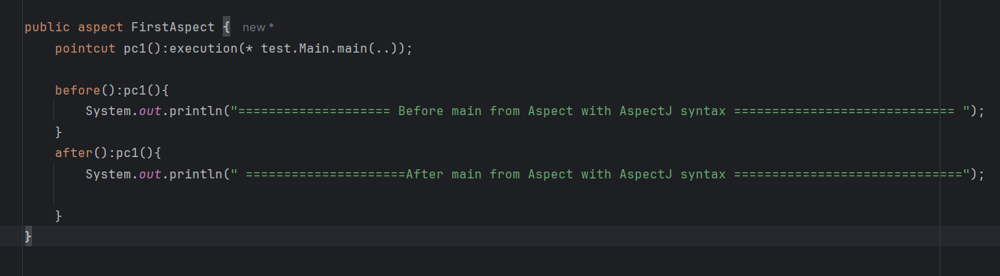
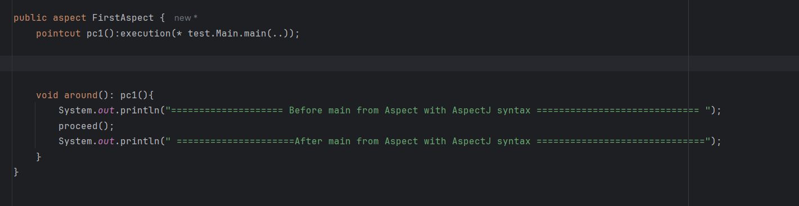
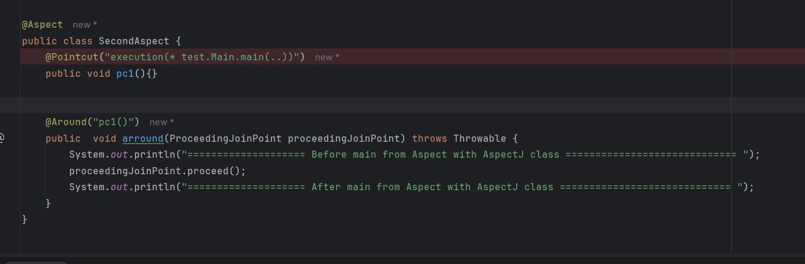
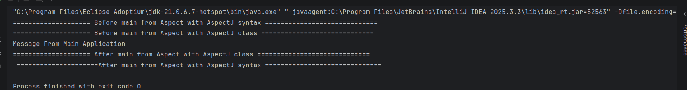
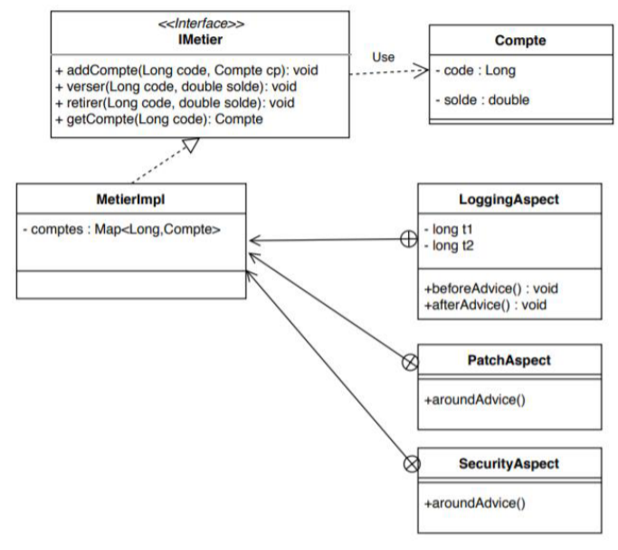
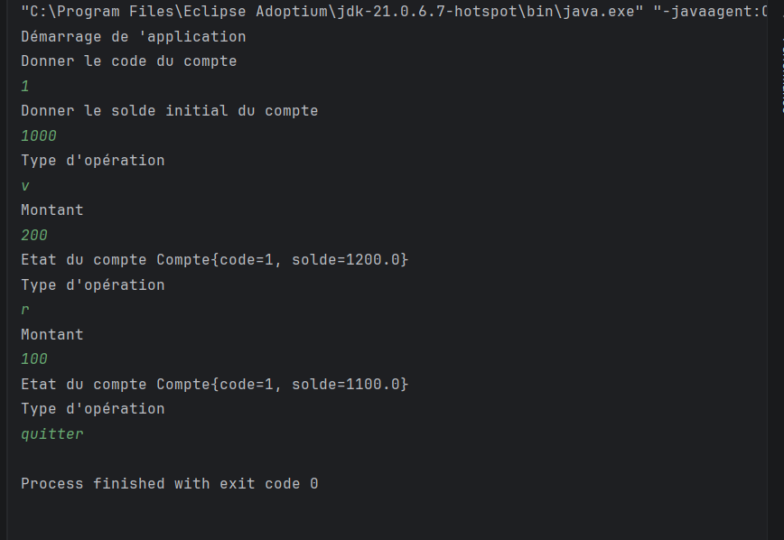
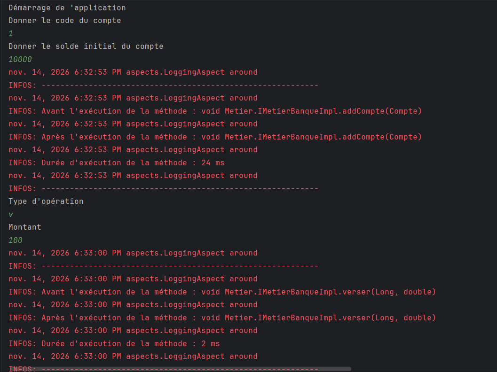
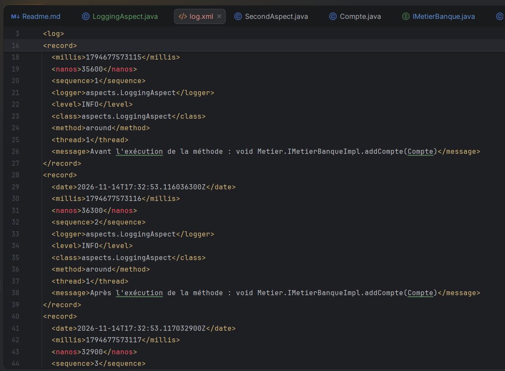
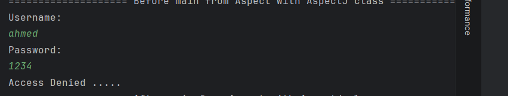
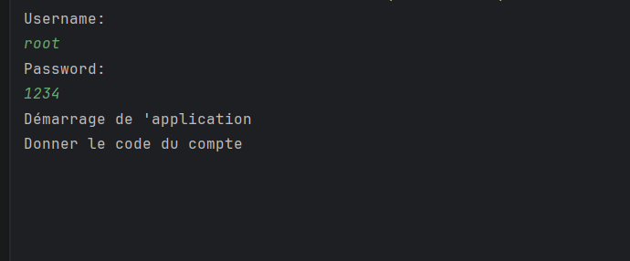

# TP : Programmation Orientée Aspect (AOP) avec AspectJ

##  Objectif du TP
Ce TP a pour but de mettre en œuvre l'approche orientée aspect (AOP) en Java. L'objectif principal est de comprendre comment ajouter des fonctionnalités techniques (comme la journalisation ou la sécurité) à une application existante, sans avoir à modifier son code source métier.

---
## 🛠 Partie 1 : Implémentation et Syntaxes d'AspectJ

### 1. Syntaxe AspectJ (Classique)
Cette approche utilise les mots-clés natifs d'AspectJ (`aspect`, `pointcut`).
*Code de l'aspect (`FirstAspect`) :* Nous définissons un pointcut ciblant la méthode `main` de l'application,

**Code After et Before :**

**Code Around :**
L'advice `around` permet d'intercepter l'appel de la méthode `main` et de contrôler explicitement son exécution via `proceed()`.

**Exécution :**
L'application affiche son message d'origine (issu de la méthode `main`), encadré par les messages injectés par l'aspect.

### 2. Syntaxe "Classe" (Annotations)
Cette deuxième syntaxe, plus moderne, est basée sur les annotations Java (`@Aspect`, `@Pointcut`, `@Before`, `@After`), toujours ciblées sur la méthode `main`.

**Code After et Before :**

**Code Around :**

**Exécution :**
On observe ici l'exécution combinée des deux aspects (syntaxe AspectJ et syntaxe Classe) qui entourent l'exécution de la méthode `main`.

---
##  Partie 2 : Application Métier et Aspects Techniques

### 1. Architecture de l'application
L'objectif est de créer une application de gestion de comptes bancaires en mode console. Le code métier est développé sans se soucier des aspects techniques (journalisation, sécurité, etc.).

**Code Métier (Exécution) :**
L'application permet d'ajouter un compte, de verser/retirer un montant et de consulter le solde. À ce stade, il n'y a aucune validation métier (le solde peut devenir négatif).

---

### 2. Aspect de Journalisation (LoggingAspect)
**Objectif** : Tracer l'exécution des méthodes de la couche métier et mesurer leur temps d'exécution sans modifier le code source.

*   **Exécution** : On observe les logs avant et après l'exécution des méthodes, avec la durée d'exécution.

    

*   **Fichier de log** : Les logs sont redirigés vers un fichier XML .

    

---

### 3. Aspect de Correction (PatchAspect)
**Objectif** : Corriger un "bug" de logique métier. L'application originale permet de retirer plus que le solde disponible. L'aspect intercepte la méthode `retirer`, vérifie le solde via `JoinPoint.getTarget()` et les arguments via `getArgs()`, et bloque l'opération si le solde est insuffisant via `proceed()`.

*   **Exécution** : L'application affiche "Solde Insuffisant" et l'opération est annulée.

    

---

### 4. Aspect de Sécurité (SecurityAspect)
**Objectif** : Ajouter un système d'authentification basique avant le démarrage de l'application. L'aspect intercepte la méthode `start()` de la classe `Application` via un advice `@Around`.

*   **Accès refusé** : Si les identifiants (ex: ahmed / 1234) sont incorrects.

    

*   **Accès autorisé** : Si les identifiants (ex: root / 1234) sont corrects, `proceed()` est appelé et l'application démarre normalement.

    

